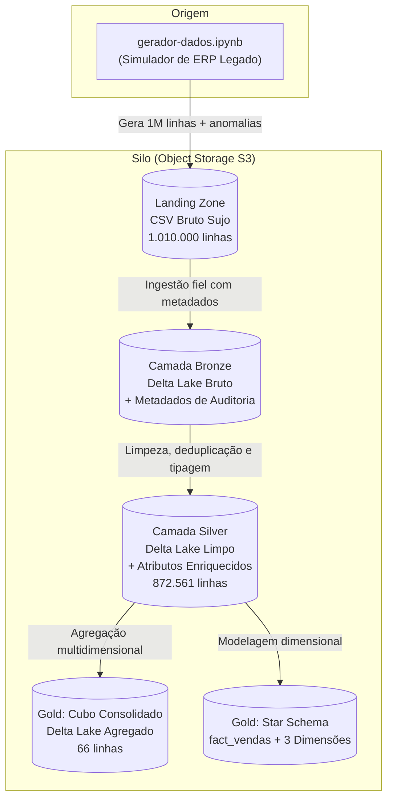
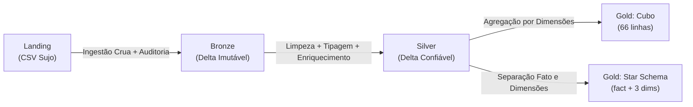

# Resumo Técnico do Pipeline de Big Data (Data Lakehouse)

Este documento descreve detalhadamente o funcionamento técnico da arquitetura implementada no projeto, abrangendo o script gerador de dados brutos ([gerador-dados.ipynb](file:///home/raisson/cdia-trabalho-big-data/gerador-dados.ipynb)) e o pipeline principal em camadas ([main.ipynb](file:///home/raisson/cdia-trabalho-big-data/main.ipynb)), baseado na **Arquitetura Medallion** (*design pattern* de engenharia de dados que organiza os dados em camadas progressivas de qualidade: Landing $\rightarrow$ Bronze $\rightarrow$ Silver $\rightarrow$ Gold).

---

## 1. Visão Geral da Arquitetura

O ecossistema utiliza três pilares principais de tecnologia:
1. **Apache Spark (PySpark 3.5.3):** Motor de processamento distribuído (*framework* para processamento paralelo de grandes volumes de dados na memória RAM).
2. **Silo / MinIO (Docker):** Armazenamento de objetos local (*Object Storage* compatível com a API AWS S3) em execução na porta `9000` (API) e `9001` (Console Web).
3. **Delta Lake 3.2.0:** Camada de armazenamento transacional sobre arquivos Parquet que adiciona garantias ACID (*Atomicidade, Consistência, Isolamento e Durabilidade*, assegurando que gravações não corrompam os dados) e versionamento (*Time Travel*).

---

## 2. Detalhamento do `gerador-dados.ipynb` (Simulador de Origem)

O objetivo deste notebook é simular a exportação bruta de um sistema transacional legado (*sistema de vendas de um ERP corporativo antigo*), propositalmente injetando problemas de qualidade de dados para testar a resiliência do pipeline.

### Passo 1: Inicialização da SparkSession
O Spark é configurado para interagir com o Silo através do protocolo `s3a://`:
* **JARs Hadoop AWS e AWS SDK (`hadoop-aws:3.3.4`, `aws-java-sdk-bundle:1.12.262`):** Bibliotecas Java necessárias para traduzir comandos de leitura e escrita do Spark para chamadas HTTP compatíveis com S3.
* **`fs.s3a.endpoint = http://localhost:9000`:** Redireciona as chamadas que iriam para a nuvem da AWS para o container Docker local.
* **`fs.s3a.path.style.access = true`:** Força o Spark a usar URLs no formato de caminho (`http://endpoint/bucket`) em vez do padrão de subdomínio da AWS (`http://bucket.endpoint`), essencial para compatibilidade com MinIO/Silo.
* **`fs.s3a.connection.ssl.enabled = false`:** Desativa a criptografia HTTPS, já que a rede interna do Docker opera em HTTP puro.

### Passo 2: Geração da Base e Injeção de Falhas (1.000.000 de registros)
A função `spark.range(0, 1_000_000)` cria a chave primária `id_venda`. Em seguida, são injetadas 6 anomalias reais de mercado:

1. **Inconsistência de Texto (Strings Sujas):**
   * *O problema:* A coluna `categoria` recebe variações do mesmo termo digitadas por usuários, como `' livros '` (espaços invisíveis), `'INFORMÁTICA'` (tudo maiúsculo), `'eletronicos'` (minúsculo e sem acento) e `'CASA'`.
   * *Mecanismo:* A função matemática `F.pmod(F.col('id_venda'), 7) + 1` (*operação de resto de divisão*) alterna ciclicamente entre uma lista de 7 variantes.

2. **Valores Nulos Induzidos (*Missing Data*):**
   * *O problema:* Registros sem preenchimento de categoria.
   * *Mecanismo:* A cada 50 vendas (`id_venda % 50 == 0`), a categoria é forçada para `None/NULL`.

3. **Anomalias de Regra de Negócio (Preços Negativos e Zerados):**
   * *O problema:* O preço unitário de um produto não pode ser menor ou igual a zero no mundo real.
   * *Mecanismo:* A função `(F.rand(42) * 500) - 50` gera preços a partir de -R\$ 50,00, e a cada 33 vendas (`id_venda % 33 == 0`) o valor é zerado propositalmente (`0.00`).

4. **Conflito Regional de Separador Decimal e Perda de Tipagem:**
   * *O problema:* O Brasil adota a vírgula como separador decimal (`150,50`), enquanto os sistemas computacionais utilizam ponto (`150.50`).
   * *Mecanismo:* Em metade das linhas (`id_venda % 2 == 0`), o ponto é trocado por vírgula e a coluna é convertida em texto (`string`), impedindo cálculos matemáticos diretos.

5. **Duplicidade de Registros (Falha de Rede):**
   * *O problema:* Falhas de conexão podem fazer o sistema de origem reenviar lotes de mensagens já processados.
   * *Mecanismo:* O comando `df_base.unionByName(df_base.limit(10_000))` repete as primeiras 10.000 vendas, elevando o volume total de 1.000.000 para **1.010.000 linhas**.

6. **Escolha de Delimitador Conflitante:**
   * *O problema:* Usar vírgula como delimitador de CSV quebraria os números com vírgula em duas colunas.
   * *Mecanismo:* O arquivo é salvo com ponto-e-vírgula (`sep=';'`).

### Passo 3: Gravação na Landing Zone
O DataFrame corrompido é gravado no formato CSV cru em:
`s3a://lakehouse/landing/vendas_cruas_csv`

---

## 3. Detalhamento do `main.ipynb` (Pipeline de Engenharia)

O notebook principal implementa a governança e refino dos dados divididos nas camadas Medallion.

### Seção 1: Inicialização do Spark com Silo e Delta Lake
Além das conexões S3A já descritas, ativa-se o motor do Delta Lake:
* **`spark.sql.extensions = io.delta.sql.DeltaSparkSessionExtension`:** Injeta comandos analíticos avançados na engine SQL nativa do Spark (*como MERGE INTO e UPDATE*).
* **`spark.sql.catalog.spark_catalog = org.apache.spark.sql.delta.catalog.DeltaCatalog`:** Substitui o catálogo de tabelas interno para habilitar logs transacionais ACID e controle de versões (*Time Travel*).

---

### Seção 2: Validação da Camada Landing
Executa a leitura direta do CSV gravado no Silo. Confirma-se que todos os campos foram carregados como texto (`string`), totalizando **1.010.000 linhas** brutas.

---

### Seção 3: Camada Bronze (Ingestão e Rastreabilidade)
A regra fundamental da Camada Bronze em um Data Lakehouse é a **fidelidade estrita à origem**: nenhuma limpeza ou filtro deve ser feito aqui para que ela funcione como histórico imutável de auditoria.

* **Metadados de Rastreabilidade (*Data Lineage*):**
  * `_data_ingestao`: Gerado via `F.current_timestamp()` (*momento exato do carregamento*).
  * `_arquivo_origem`: Capturado via `F.input_file_name()` (*identificação de qual arquivo físico continha aquele registro*).
* **Gravação Delta:** Salvo em `s3a://lakehouse/bronze/vendas` no formato Delta Lake.
* **Versionamento (*Time Travel*):** Através do comando `DeltaTable.forPath(spark, CAMINHO_BRONZE).history()`, é possível auditar cada operação registrada no log (`_delta_log`), com carimbo de data/hora e métricas de bytes e arquivos gerados.

---

### Seção 4: Camada Silver (Limpeza, Confiabilidade e Enriquecimento)

A camada Silver consome os dados da Bronze e resolve todas as falhas técnicas e de negócio:

#### 1. Tratamento das Falhas
1. **Deduplicação:** `df_bronze.dropDuplicates(['id_venda'])` elimina os 10.000 registros repetidos, retornando a base para exatamente 1.000.000 de linhas únicas.
2. **Correção de Tipagem e Vírgula Decimal:**
   * `F.regexp_replace(col('preco_unitario'), ',', '.')` padroniza o separador para ponto.
   * Conversão explícita para tipos adequados: `id_venda` em `long` (*inteiro de 64 bits*), `quantidade` em `integer` (*inteiro de 32 bits*), `preco_unitario` e `desconto` em `decimal(10, 2)` (*número decimal de precisão fixa, evitando erros de ponto flutuante em finanças*).
3. **Padronização Categórica e Tratamento de Nulos:**
   * `F.trim()` remove espaços em branco extras.
   * `F.when().otherwise()` converte valores ausentes/`NULL` em `'Não Informado'` (*preservando os registros de faturamento*) e unifica termos duplicados (`'eletronicos'`, `'INFORMÁTICA'`, etc.) para formas canônicas padronizadas.
4. **Filtro de Anomalias de Negócio:**
   * `.filter((col('preco_unitario') > 0) & (col('quantidade') > 0))` remove preços negativos e zerados.
   * **Resultado da Limpeza:** A base passa a ter **872.561 registros limpos e confiáveis**.

#### 2. Engenharia de Atributos (Enriquecimento)
Antes de persistir na Silver, são criadas quatro novas colunas derivadas (*mínimo necessário para análise de receita e geografia*):
* **`valor_bruto`** (`quantidade * preco_unitario`): Faturamento bruto da transação.
* **`valor_desconto`** (`valor_bruto * desconto`): Valor monetário efetivo do desconto aplicado (*lembrando que o valor 0.05 equivale a 5% de desconto no PIX*).
* **`valor_liquido`** (`valor_bruto - valor_desconto`): Valor financeiro real recebido pela venda.
* **`regiao`**: Mapeamento da `filial_uf` em macrorregiões brasileiras (`'RS'`, `'SC'`, `'PR'` $\rightarrow$ `'Sul'`, `'SP'` $\rightarrow$ `'Sudeste'`).
* **`_data_processamento_silver`**: Timestamp de auditoria do processamento da Silver.

Os dados enriquecidos são gravados na tabela Delta em `s3a://lakehouse/silver/vendas` utilizando `.option('overwriteSchema', 'true')` para aplicar as novas colunas no esquema da tabela.

---

### Seção 5: Camada Gold (Modelagem Analítica e Business Intelligence)

Na camada Gold, os dados da Silver são preparados para o consumo por analistas de negócio e ferramentas de visualização (como Power BI e Tableau). Foram implementadas duas abordagens distintas:

#### 5.1 Cubo Analítico Consolidado (Tabela Multidimensional Única)
* **Conceito:** Uma tabela analítica agregada no grão (*nível de detalhe*) de `regiao`, `filial_uf`, `categoria` e `forma_pagamento`.
* **Métricas Pré-calculadas:**
  * `total_pedidos`: Contagem total de vendas (`count(id_venda)`).
  * `total_itens_vendidos`: Soma de quantidades vendidas (`sum(quantidade)`).
  * `faturamento_bruto`: Soma de faturamento antes dos descontos.
  * `total_descontos`: Soma de descontos concedidos.
  * `faturamento_liquido`: Receita líquida final.
  * `ticket_medio_pedido`: Média do valor líquido gasto por compra.
* **Resultado:** Reduz 872.561 linhas a apenas **66 linhas altamente resumidas**, permitindo respostas instantâneas em gráficos de barras, pizza ou tabelas dinâmicas. Gravado em `s3a://lakehouse/gold/vendas_consolidadas`.

#### 5.2 Modelo Dimensional Star Schema (Tabela Fato e Dimensões)
* **Conceito:** Padrão clássico de Data Warehouse (*modelo dimensional de Ralph Kimball*) que separa as métricas quantitativas (Fato) dos atributos descritivos de filtragem (Dimensões).
* **Tabelas Geradas no Delta Lake:**
  1. **`dim_filial` (`s3a://lakehouse/gold/dim_filial`):** Dimensão geográfica com `filial_uf` e `regiao` (4 registros únicos).
  2. **`dim_categoria` (`s3a://lakehouse/gold/dim_categoria`):** Dimensão de produtos com `categoria` (6 categorias únicas).
  3. **`dim_pagamento` (`s3a://lakehouse/gold/dim_pagamento`):** Dimensão com `forma_pagamento` e `desconto_padrao` (3 métodos: PIX, Cartão, Boleto).
  4. **`fact_vendas` (`s3a://lakehouse/gold/fact_vendas`):** Tabela fato detalhada preservando o identificador `id_venda`, chaves estrangeiras para as dimensões e as métricas numéricas (`quantidade`, `preco_unitario`, `valor_bruto`, `valor_desconto`, `valor_liquido`).
* **Vantagem:** Permite que ferramentas de BI criem medidas DAX (*linguagem de cálculo do Power BI*) e realizem análises granulares sem duplicar atributos descritivos.

---

## 4. Glossário Técnico de Termos Complexos

| Termo Técnico | Significado Explicativo |
| :--- | :--- |
| **Arquitetura Medallion** | Padrão arquitetural de Data Lakehouse que divide o dado em camadas sucessivas de maturidade e confiabilidade (Bronze = cru, Silver = limpo, Gold = agregado). |
| **ACID** | Conjunto de 4 propriedades (*Atomicidade, Consistência, Isolamento, Durabilidade*) que garantem que operações em lote no banco nunca fiquem gravadas "pela metade" em caso de falha. |
| **Delta Lake** | Camada de código aberto que traz logs transacionais JSON (`_delta_log`) sobre arquivos Parquet compactados, viabilizando recursos de banco relacional em Data Lakes. |
| **Time Travel** | Capacidade nativa do Delta Lake de consultar o estado exato de uma tabela em versões ou carimbos de tempo anteriores (*histórico de auditoria*). |
| **Path-style Access** | Modo de endereçamento HTTP no formato `http://host:porta/bucket` utilizado por armazenamentos locais S3-compatíveis (como MinIO/Silo), diferindo do `http://bucket.host` da AWS comercial. |
| **Parquet** | Formato de armazenamento em arquivos colunares compactados (*Snappy*), otimizado para consultas analíticas rápidas de leitura em Big Data. |
| **Star Schema** | Modelo dimensional composto por uma tabela fato central (*números e transações*) conectada a tabelas dimensão periféricas (*contextos como quem, onde e o quê*). |
| **S3A** | Conector do Apache Hadoop que implementa o protocolo de comunicação cliente para sistemas de arquivos compatíveis com o Amazon S3. |
| **Deduplicação** | Operação de eliminação de registros com identificadores repetidos originados por reenvios de pacotes ou falhas sistêmicas. |
| **Cast** | Conversão forçada de um tipo de dado primitivo para outro (por exemplo: converter a string `"45.90"` para o tipo `decimal(10, 2)`). |

---

> [!TIP]
> Todos os arquivos de dados gerados nas camadas Landing, Bronze, Silver e Gold residem no volume Docker gerenciado pelo Silo e podem ser inspecionados visualmente através do console web em [http://localhost:9001](http://localhost:9001) (Usuário: `admin` | Senha: `password123`).
